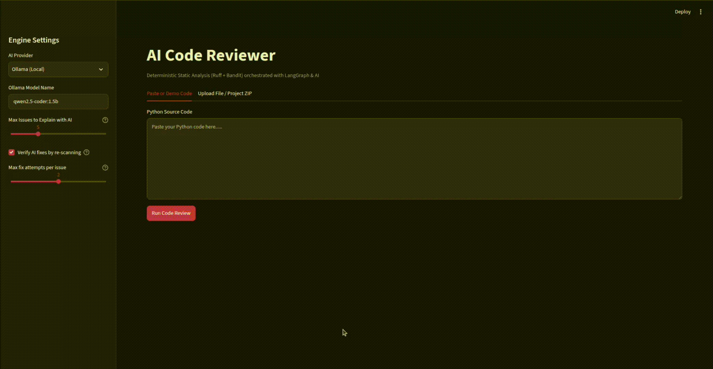

<div align="center">

# AI Code Reviewer

**Deterministic static analysis finds the bugs. A local AI explains and fixes them. A verifier checks the fix.**

[](https://www.python.org/)
[](https://streamlit.io/)
[](https://langchain-ai.github.io/langgraph/)
[](https://docs.astral.sh/ruff/)
[](https://bandit.readthedocs.io/)
[](https://ollama.com/)
[](LICENSE)



</div>

---

## 📖 Overview

**AI Code Reviewer** is an app that reviews Python code in two stages: first with **deterministic scanners**, then with an **LLM**.

[Ruff](https://docs.astral.sh/ruff/) (quality and bugs) and [Bandit](https://bandit.readthedocs.io/) (security) decide *what* is wrong, so findings never come from a model's imagination. The LLM is only asked to explain *why* each finding matters and to propose a fix. Paste a snippet, upload a `.py` file, or drop in a whole project as a `.zip`. Every finding appears next to your source code with a severity, a code context window, an AI explanation, and a suggested fix.

It runs fully offline with a local [Ollama](https://ollama.com/) model, or you can use any model on [OpenRouter](https://openrouter.ai/). There is also a **static-analysis-only** mode that needs no AI at all.

> **Design principle:** a security tool must never say "clean" when it didn't actually scan. If Ruff or Bandit crashes, times out, or isn't installed, the app shows an error instead of a green checkmark.

> Built as part of a walkthrough video by **YantraCode** — [watch it here](https://youtu.be/mU9xZE9cabk)

---

## ✨ Features

- 🧪 **Two scanners, one view**: Ruff (`E, F, B, W`) and Bandit run on every scan and are merged, de-duplicated by design, and sorted by severity
- 🧠 **AI root cause explanations**: a 2-3 sentence explanation of why each issue is risky, plus a corrected code snippet
- ✅ **Fix verification**: suggested fixes go through a verification step, and the result is shown as a verification log on each finding
- 🔀 **Pluggable LLM backends**: local **Ollama**, cloud **OpenRouter**, or **no AI** (scanners only)
- 📦 **Three input modes**: paste code, upload a `.py` file, or upload a project `.zip`
- 🖥️ **Split screen dashboard**: line-numbered source on the left, findings and fixes on the right, with the flagged line marked `>>`
- 📊 **Severity scorecard**: file count, total issues, and High / Medium / Low counts at a glance
- 📄 **Downloadable report**: export the full review as Markdown
- ⚡ **Live progress**: per-step status (discover files, run scanners, AI review, compile report) streamed to the UI
- 🛡️ **Safe by default**: hardened zip extraction, private per-scan temp directories, scanner failures surfaced instead of hidden
- 🎛️ **Cost and speed control**: a slider caps how many findings are sent to the LLM per scan

---

## How It Works

The review is a four-stage [LangGraph](https://langchain-ai.github.io/langgraph/) pipeline. Each node reads and writes a shared typed state (`core/state.py`).


| Stage | What happens |
|---|---|
| **1. discover_files** | Finds all `.py` files (skipping `venv`, `.git`, `node_modules`, `site-packages`, `__pycache__`) and caches their text so the UI never re-reads the disk |
| **2. static_analysis** | Runs Bandit and Ruff as subprocesses, normalizes results to one schema, sorts by severity, and attaches a numbered display snippet plus a plain-code snippet for the LLM |
| **3. ai_review** | Checks the provider once up front, then asks the model to explain and fix the top-N findings in parallel. Fixes are verified and logged |
| **4. compile_report** | Builds the Markdown report, including a **Warnings** section whenever a scanner or the AI step had a problem |

### Severity model

| Source | Rule | Severity |
|---|---|---|
| Bandit | `HIGH` / `MEDIUM` / `LOW` | Kept as-is |
| Ruff | Bugbear (`B*`), undefined names (`F8*`), syntax / `E9*` errors | **Medium** |
| Ruff | Everything else (style, unused imports, whitespace) | **Low** |

Ruff's `S` (security) rules are deliberately **not** enabled because they duplicate Bandit. `E501` (line length) is ignored to cut noise.

---

## 🛠️ Tech Stack

| Layer | Technology |
|---|---|
| UI | Streamlit |
| Orchestration | LangGraph |
| LLM access | LangChain (`langchain-ollama`, `langchain-openai`) |
| Quality / bug linting | Ruff |
| Security scanning | Bandit |
| Configuration | python-dotenv |

---

## 📁 Project Structure

```
Code_Reviewer
├── core/
│   ├── tools/
│   │   ├── bandit_scanner.py   # Runs Bandit, normalizes security findings
│   │   ├── ruff_scanner.py     # Runs Ruff, normalizes quality findings
│   │   ├── file_handler.py     # Workspaces, safe zip extraction, file discovery, snippets
│   │   └── common.py           # Shared subprocess runner, ScannerError, path helpers
│   ├── agent.py                # LLM provider setup, health check, response parsing
│   ├── graph.py                # LangGraph pipeline and node functions
│   ├── prompts.py              # Review prompt (explanation + fix format)
│   ├── report.py               # Markdown report generation
│   ├── state.py                # Typed state shared between graph nodes
│   └── verifier.py             # Verification of AI-suggested fixes
├── assets/
│   └── Demo.gif
├── app.py                      # Streamlit UI, input handling, results dashboard
├── requirements.txt
├── .gitignore
├── .env.example
└── README.md
```

---

## 🚀 Getting Started

### Prerequisites

- Python 3.10+
- **For local AI (recommended):** [Ollama](https://ollama.com/download) installed and running
- **For cloud AI (optional):** an [OpenRouter](https://openrouter.ai/) API key

### Installation

```bash
# Clone the repository
git clone https://github.com/YantraCode-ai/AI_Code_Reviewer.git
cd AI_Code_Reviewer

# Create and activate a virtual environment
python -m venv venv
source venv/bin/activate      # Windows: venv\Scripts\activate

# Install dependencies
pip install -r requirements.txt
```

### Configuration

Copy the example file and edit it:

```bash
cp .env.example .env          # Windows: copy .env.example .env
```

```env
# Only needed if you select OpenRouter in the UI
OPENROUTER_API_KEY=your_openrouter_api_key_here

# Local Ollama settings
OLLAMA_BASE_URL=http://localhost:11434
DEFAULT_OLLAMA_MODEL=
DEFAULT_OPENROUTER_MODEL=
```

### Pull a local model (Ollama)

```bash
ollama pull qwen2.5-coder:7b
```

### Running the app

```bash
streamlit run app.py
```

Open the local URL Streamlit prints (typically `http://localhost:8501`). The sample buggy code is pre-loaded, so just click **Run Code Review**.

> No GPU or model handy? Pick **Static Analysis Only (No AI)** in the sidebar. Ruff and Bandit run without any LLM.

---

## 🧑‍💻 Usage

1. **Pick an AI provider** in the sidebar: Ollama (Local), OpenRouter (Cloud), or Static Analysis Only.
2. **Set the model name** (defaults come from `.env`) and the **Max Issues to Explain with AI** slider (1-15).
3. **Choose an input**:
   - **Paste or Demo Code**: tick *Load sample buggy Python code* for a one-click demo.
   - **Upload File / Project ZIP**: a single `.py` file or a zipped project.
4. **Read the results**: the scorecard summarizes counts, the left pane shows source, and the right pane lists findings. Expand any finding to see the code context, AI explanation, suggested fix, and verification log.
5. **Download** the full report as Markdown.

### What the demo catches

| Planted flaw | Reported by |
|---|---|
| Unused `import sys` | Ruff `F401` |
| Hardcoded password string | Bandit `B105` |
| `subprocess.Popen(..., shell=True)` | Bandit `B602` |
| Mutable default argument `target_list=[]` | Ruff `B006` |
| Bare `except:` | Ruff `E722` |

---

## 🩺 Troubleshooting

| Symptom | Likely cause and fix |
|---|---|
| `AI review skipped: Cannot reach Ollama...` | Ollama isn't running. Start it with `ollama serve`, and check `OLLAMA_BASE_URL` |
| `Ollama model '...' is not installed` | Run `ollama pull <model-name>` |
| `Error code: 403` on AI explanations | The provider refused the request. For OpenRouter, check your account's data-policy settings, regional availability of the model, and try a different model. For Ollama, check `OLLAMA_ORIGINS` and proxy variables (`NO_PROXY=localhost,127.0.0.1`) |
| `Ruff failed` / `Bandit failed` | Run `pip install -r requirements.txt` inside your active virtual environment |
| `OPENROUTER_API_KEY is missing` | Add the key to `.env` and restart Streamlit |
| `Upload rejected: Unsafe path in archive` | The zip contains entries that escape the extraction folder. Re-create the zip from the project root |
| "No Python (.py) files were found" | The zip had no `.py` files outside skipped folders such as `venv` or `node_modules` |

---

## 🗺️ Roadmap

- [ ] Support for more languages (JavaScript / TypeScript via ESLint)
- [ ] Auto-apply verified fixes and export a patch / diff
- [ ] Persistent review history
- [ ] GitHub pull-request integration and a CI mode
- [ ] SARIF export for code-scanning dashboards
- [ ] Editable system prompt and per-model presets
- [ ] Docker support

---

## 🤝 Contributing

Contributions are welcome! Please open an issue to discuss significant changes before submitting a pull request.

1. Fork the repository
2. Create a feature branch (`git checkout -b feature/my-feature`)
3. Commit your changes
4. Open a pull request

---

## 📄 License

Distributed under the MIT License. See [LICENSE](LICENSE) for details.

---

<div align="center">
Built and maintained by <a href="https://github.com/yantracode-ai">YantraCode</a>
<br>Authored By: Akshat Gupta
</div>